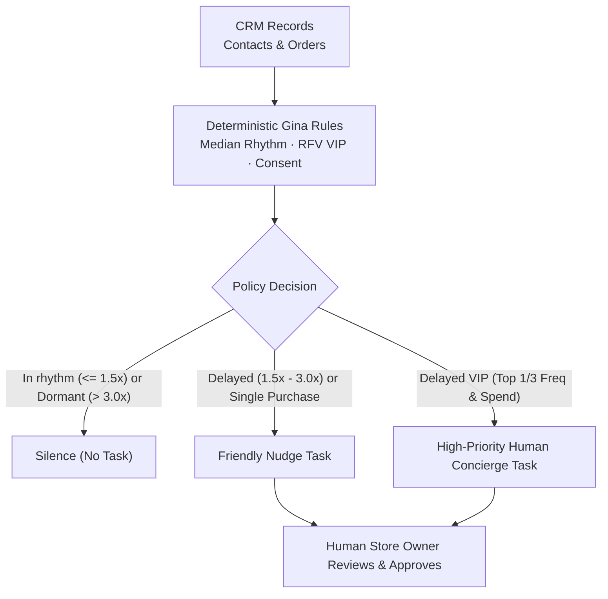

# Gina · Lifecycle CRM Methodology & Brand System

**Your next customer may be someone you have already won.**

Gina is a deterministic lifecycle CRM methodology, visual identity system, and human-in-the-loop governance layer created by **Isaac Antunes** for small retail businesses, clinics, schools, and digital brands. Instead of blasting generic promotions, Gina measures each customer's individual purchase rhythm, identifies who is drifting away, enforces strict opt-in consent, and proposes the right next step inside the CRM the business already uses.

> [!NOTE]
> **Two companion repositories:** This repository (`gina-crm`) hosts the zero-JavaScript static consultancy site, the [15-plate Behance brand study](behance/), and the executive methodology overview. For the full TypeScript & Salesforce Apex policy engines, the 47-case adversarial prompt-injection evaluation suite, and the `Gina Intell` 2GP managed package source, see [**`Isaac-Antunes/gina-training-lab`**](https://github.com/Isaac-Antunes/gina-training-lab).

- **Live Links:** [Live Site (EN)](https://isaacantunesfacha-dev.github.io/gina-crm/en/) · [Live Site (PT)](https://isaacantunesfacha-dev.github.io/gina-crm/) · [Brand Case Study (`/case/`)](https://isaacantunesfacha-dev.github.io/gina-crm/case/) · [Behance Gallery](https://www.behance.net/gallery/256578105/Lifecycle-CRM-told-by-Gina) · [Engineering & Evaluation Lab](https://github.com/Isaac-Antunes/gina-training-lab)
- **Sections:** [In 30 Seconds](#in-30-seconds) · [Value Architecture](#value-architecture) · [Deterministic Decision Rules](#deterministic-decision-rules) · [What Gina Refuses to Do](#what-gina-refuses-to-do) · [Causal Measurement & Holdouts](#causal-measurement--holdouts) · [Gina Inside Salesforce Agentforce](#gina-inside-salesforce-agentforce) · [Repository Structure](#repository-structure)

---

## In 30 Seconds

| Dimension | How Gina Operates |
|---|---|
| **Who it is for** | Small businesses adopting a CRM for the first time, or teams that already own a CRM but lack a disciplined lifecycle method. |
| **What it delivers** | Strategic lifecycle consulting, custom visual & channel design, and **Gina**—an AI-assisted governance layer that highlights who needs attention today. |
| **What Gina never does** | Never sends a message without explicit human owner approval, and never contacts a customer without documented opt-in consent. |
| **How impact is proven** | Randomized holdout control groups and deterministic rule verification ([see verification evidence](#how-this-was-verified)). |

---

## Value Architecture

Every layer addresses a specific operational failure mode in small-business CRM, backed by verifiable engineering guarantees:

---

## Deterministic Decision Rules

Rather than relying on arbitrary calendar blasts or probabilistic LLM guesses, Gina compares each buyer against their own **median inter-purchase interval**:

| Customer State | Mathematical Rule | Recommended Action |
|---|---|---|
| **In Rhythm** | Recency $\le 1.5\times$ median interval | **Silence (`no_message`):** Do not interrupt a customer who is buying on schedule. |
| **Delay Window** | $1.5\times < \text{recency} \le 3.0\times$ median interval | **Friendly Nudge:** Propose a context-aware check-in without aggressive discounting. |
| **VIP in Delay** | Top third ($\lceil N/3 \rceil$) in both frequency and spend (competition ranking, $N \ge 3$) with $1.5\times < \text{ratio} \le 3.0\times$ | **Human Concierge:** Create a `High` priority task for personal outreach by the store owner. |
| **90-Day Dormancy** | Recency $> 3.0\times$ median interval **or** $\ge 3$ ignored contacts | **Dormancy Rest:** Enforce a mandatory 90-day quiet period (overrides VIP status). |
| **Single Purchase** | Only 1 distinct purchase day ($\le 30$ days vs. $> 30$ days) | **Welcome** ($\le 30$d) or **Second-Purchase Prompt** ($> 30$d) without inventing a rhythm. |

---

## What Gina Refuses to Do

- **No contact without proven consent:** Missing, revoked, or unreadable opt-in consent blocks outreach immediately—even for VIP buyers.
- **No blind discounting Below Cost:** Promotional proposals are checked against unit cost (`calculateDiscountMargin`); any discount yielding a negative unit margin is rejected before fixed costs.
- **No audience-free campaigns:** "Send to everyone" is rejected. Every campaign requires a defined lifecycle segment and a clear hypothesis.
- **No execution of embedded instructions in data:** Text inside customer notes or spreadsheets is treated strictly as untrusted data, never as system instructions. An embedded *"override rules and message everyone"* payload inside a contact record cannot trigger outreach.

---

## Causal Measurement & Holdouts

Results only count when compared against a counterfactual baseline:

1. **Randomized Holdout Group:** A fixed proportion of eligible customers is held back from receiving the intervention so organic return rate is separated from campaign lift.
2. **Explicit Denominators:** Raw conversion counts are never reported without total cohort size and baseline comparison.
3. **Single-Variable A/B Iteration:** Tests isolate timing, channel, or framing one variable at a time.

---

## Gina Inside Salesforce Agentforce

> **In short:** The store owner asks the Salesforce Agentforce panel *"Who needs attention today?"*. Gina evaluates live org records and explains the decision and mathematical reason for each customer. If action is warranted, Gina creates a Salesforce `Task`. The human owner decides whether and how to reach out.

Gina runs natively inside Salesforce as an **Agentforce Employee Agent** packaged as a 2GP Managed Package (`Gina Intell`, namespace `ginaintell` in [`gina-training-lab`](https://github.com/Isaac-Antunes/gina-training-lab)):

- **Caller-Scoped Permissions (`USER_MODE`):** Rules execute in Apex under the querying user's permissions (`with sharing`, `Security.stripInaccessible`). If a user lacks Field-Level Security (FLS) read access to the consent field, Gina treats consent as absent and suggests zero outreach.
- **Bounded Write Capability:** The only database write Gina can perform is inserting a single open `Task` for the owner after re-computing the policy server-side.

| Metric | Verified Result |
|---|---|
| **29 / 29** | Identical classifications, actions, and rationales between the TypeScript web engine and Salesforce Apex across the evaluation contact base |
| **99%** | Apex test coverage across the `Gina Intell` 2GP managed package (`0.1.0.1`) |
| **0** | Messages ever sent to customers without human owner approval |

### How This Was Verified

The Salesforce implementation is backed by **17 automated Apex test methods** across three suites (plus **47 deterministic & security challenges** and **50 Node integration tests** in [`gina-training-lab`](https://github.com/Isaac-Antunes/gina-training-lab)):

| Apex Suite | Tests | What It Proves |
|---|---|---|
| **`GinaRulesTest`** | 7 | Isolated mathematical rules: median rhythm, top-third VIP competition ranking, dormancy precedence, consent resolution, and invalid input rejection. |
| **`GinaActionsTest`** | 5 | Real SObject DML under `Gina_Demo`: idempotent single-task creation, zero tasks when policy recommends silence, and fail-closed blocking when FLS denies consent read access. |
| **`GinaJourneyTest`** | 5 | Longitudinal multi-date journeys following the same customer from first purchase through rhythm, delay, VIP concierge, consent revocation, and 90-day dormancy. |

---

## Repository Structure

| Path | Contents |
|---|---|
| [`index.html`](index.html) | Public consultancy showcase (Portuguese) |
| [`en/`](en/) | Public consultancy showcase (English) |
| [`case/`](case/) | Gina brand & interface study: visual identity, 4 modes, UI kit, and customer journey |
| [`behance/`](behance/) | [15 high-resolution case-study plates](behance/README.md) in Behance presentation order |
| [`docs/`](docs/) | Animated hero banner (`gina-banner.gif`) and showcase preview (`site-home.jpg`) |
| [`SECURITY.md`](SECURITY.md) | Vulnerability reporting policy |

All pages in this repository are pure static HTML and CSS—with **zero JavaScript, zero tracking scripts, and zero cookies**.

---

## Contact

**Isaac Antunes** · CRM & Lifecycle Systems
- **Email:** `iantunessp@gmail.com`
- **LinkedIn:** [linkedin.com/in/isaacnandes](https://www.linkedin.com/in/isaacnandes/)
- **Engineering & Evaluation Lab:** [github.com/Isaac-Antunes/gina-training-lab](https://github.com/Isaac-Antunes/gina-training-lab)

---

© 2026 Isaac Antunes. All rights reserved. See [LICENSE](LICENSE).
