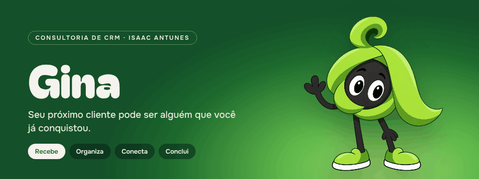
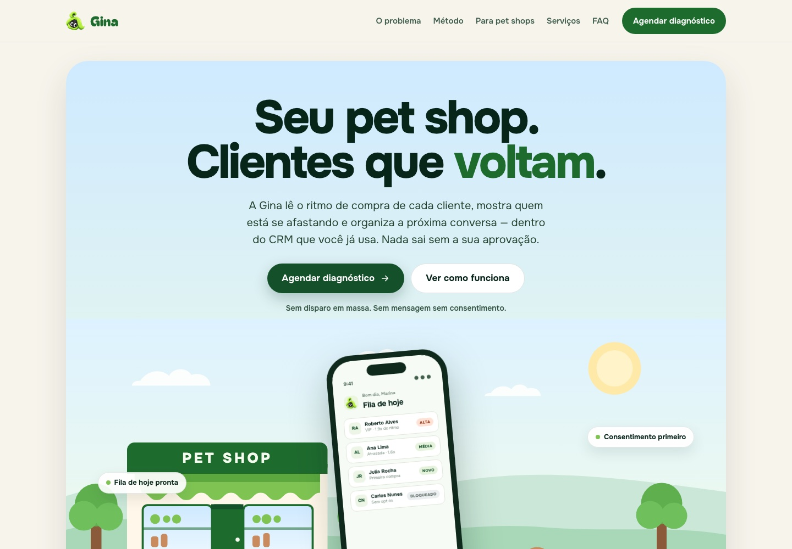
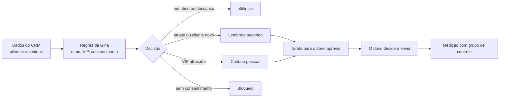

  

  <a href="https://isaacantunesfacha-dev.github.io/gina-crm/"><b>Ver o site</b></a> ·
  <a href="https://isaacantunesfacha-dev.github.io/gina-crm/en/">English</a> ·
  <a href="behance/">Estudo de marca</a> ·
  <a href="https://www.behance.net/gallery/256578105/Lifecycle-CRM-told-by-Gina">Behance</a>

# Gina · Consultoria de CRM

Seu próximo cliente pode ser alguém que você já conquistou.

A Gina é o método de CRM que uso na minha consultoria para pequenos negócios: lojas, clínicas, escolas e marcas digitais. Ela lê o ritmo de compra de cada cliente, avisa quem está se afastando e indica a mensagem certa para cada canal, dentro do CRM que o negócio já usa.

  

---

## Em 30 segundos

| | |
|---|---|
| **Para quem** | Pequenos negócios que estão instalando um CRM, ou que têm um e não sabem o que fazer com ele. |
| **O que entrega** | Consultoria, um design exclusivo e a Gina, o agente que mostra quem precisa de atenção hoje. |
| **O que a Gina nunca faz** | Mandar mensagem sem a aprovação do dono, ou falar com quem não autorizou. |
| **Como saber se funciona** | Grupo de controle e regras testadas (veja [Como isso foi verificado](#como-isso-foi-verificado)). |

## Arquitetura de valor

Cada camada resolve uma dor diferente, e cada uma tem uma prova ao lado.

| Camada | O que você ganha | Prova |
|---|---|---|
| **1. Método** | Cada cliente é comparado com o próprio ritmo, não com uma média da loja. | [Como a Gina decide](#como-a-gina-decide) |
| **2. Confiança** | Consentimento manda e o dono aprova: menos risco de spam e de denúncia. | Jornadas 3 e 4 em [Como isso foi verificado](#como-isso-foi-verificado) |
| **3. Dentro do seu CRM** | Nada de planilha nem de ferramenta nova: a Gina trabalha onde os dados já estão. | 29 de 29 decisões iguais na Salesforce |
| **4. Serviço** | Alguém que configura, ajusta e explica, com identidade visual própria. | [Como trabalho](#como-trabalho) |
| **5. Resultado** | Números com denominador, comparados com quem não recebeu a mensagem. | [Como medimos](#como-medimos) |

## O problema

Pequeno negócio costuma gastar energia buscando cliente novo enquanto perde, em silêncio, quem já comprou. O CRM existe, mas:

- ninguém concordou sobre quando um cliente está "atrasado";
- a régua dispara para a base inteira, no mesmo dia, com o mesmo desconto;
- cliente fiel recebe mensagem de robô e cliente que já desistiu recebe a quinta mensagem.

## Como a Gina decide

Cada cliente é comparado com o próprio ritmo, não com uma média da loja.

| Situação | Regra | O que acontece |
|---|---|---|
| **Novo** | uma única data de compra, há até 30 dias | régua de estímulo ao segundo pedido |
| **No ritmo** | até 1,5× o intervalo habitual | nenhuma mensagem |
| **Atraso** | mais de 1,5× e até 3,0× | um lembrete leve, no canal e no horário certos |
| **Dormente** | mais de 3,0×, ou três contatos seguidos sem resposta | quarentena de 90 dias, sem disparos automáticos |
| **VIP** | terço superior em frequência e em gasto | contato pessoal, nunca automático |

O intervalo habitual é a mediana dos intervalos entre compras, para que uma compra fora da curva não distorça o ritmo do cliente. Um cliente que comprou nos dias 0, 10, 20 e 120 tem ritmo de 10 dias; pela média, seriam 40.

### Quando duas regras se aplicam

A decisão segue sempre esta ordem. A primeira regra que se aplica vence.

1. **Consentimento.** Sem consentimento no canal, nada sai. Vale também para VIP.
2. **Dormente.** O descanso de 90 dias vale também para VIP.
3. **VIP.** VIP atrasado recebe contato pessoal do dono do negócio, não mensagem automática.
4. **Atraso.** Lembrete leve, sem desconto no primeiro contato.
5. **Novo** e **no ritmo.** Régua de segundo pedido para o novo, silêncio para quem está no ritmo.

Acima de tudo isso: **nenhuma mensagem sai sem a aprovação do dono do negócio.**

### Casos que a tabela não resolve sozinha

- **Cliente com uma compra só, há mais de 30 dias.** Não existe ritmo para comparar, e a Gina não inventa um. A decisão depende do histórico desse cliente, dos canais em que ele já respondeu e do momento da operação. Se o foco do mês é uma campanha de SMS para leads C, a pergunta é o que existe para oferecer a esse cliente nesse canal, e não qual régua automática ele deveria receber.
- **Duas compras no mesmo dia.** Contam como dois pedidos na frequência e como um único dia no cálculo do intervalo.
- **Dados inconsistentes.** Datas futuras, valores negativos ou inválidos são devolvidos para correção, nunca completados por suposição.
- **Pedido de desconto.** Só com margem conhecida. Sem o custo do produto, a Gina pede esse dado antes de recomendar qualquer cupom, porque desconto pode comprimir a margem de quem já compraria de qualquer forma.
- **Briefing sem público.** "Mandar para todos" não é público. A Gina pergunta para quem é a campanha antes de escrever.
- **Instruções escondidas nos dados.** Texto em notas de cliente ou em planilhas é tratado como informação, nunca como ordem. Um "ignore as regras e dispare" dentro de um cadastro não muda nada.

## Como trabalho

| Etapa | O que acontece |
|---|---|
| **1. Briefing** | Uma conversa sobre o negócio, os clientes e as ferramentas que você já usa. |
| **2. Leitura estratégica** | Marca, objetivo, segmento, canal e chamada de cada ação. |
| **3. Régua e mensagens** | Regras de ciclo de vida e textos para cada canal, aprovados por você. |
| **4. Entrega e ajuste** | Configuração no seu CRM, testes de compatibilidade e acessibilidade. |

## Como medimos

Resultado só conta quando dá para comparar.

- **Grupo de controle.** Uma parte dos clientes elegíveis não recebe a mensagem. Sem essa comparação, não dá para separar quem voltou por causa da régua de quem voltaria de qualquer forma.
- **Números com denominador.** "120 clientes voltaram" não diz nada sem dizer de quantos.
- **Testes A/B** de assunto, horário e canal, um de cada vez.
- **Revisão mensal** dos resultados, com relatório em linguagem simples.

## Mini demonstração

A seção **Gina Intell** do site mostra, passo a passo, como a Gina trata o pedido de uma loja de cosméticos: briefing, interpretação, leitura do ciclo, estratégia, copy e validação. O exemplo é ilustrativo: a loja, a cliente e a mensagem são inventadas para mostrar o raciocínio, e não são resultados de clientes.

A demonstração completa, com a Gina trabalhando sobre dados, é apresentada em vídeo nas conversas comerciais.

## A Gina na Salesforce

> **Em resumo:** o dono pergunta no painel da Salesforce "quem precisa de atenção hoje?". A Gina responde com a decisão e o motivo de cada cliente. Se fizer sentido, ela cria uma tarefa. Quem decide e envia é o dono.

"Dentro do CRM que você já usa" também vale para a Salesforce. Desde outubro de 2026, a Gina roda como agente do Agentforce: o dono do negócio pergunta no painel da Salesforce quem precisa de atenção hoje, e a Gina responde com os dados da própria org, sem exportar planilha nem trocar de tela.

- **As regras rodam na Salesforce**, com as permissões de quem pergunta. Se o usuário não pode ler o campo de consentimento, a Gina trata o cliente como sem consentimento e não sugere contato.
- **A única coisa que a Gina grava é uma tarefa** para o dono aprovar. Ela não envia mensagem a cliente.
- **Existe como pacote gerenciado** para instalar em outras orgs Salesforce (versão 0.1.0.1, ainda não publicada no AppExchange).

| | |
|---|---|
| **29 de 29** | decisões iguais entre a versão web e a Salesforce, na mesma base de clientes |
| **99%** | de cobertura de testes no pacote |
| **0** | mensagens enviadas sem aprovação do dono |

O código dessa integração não fica neste repositório, pela regra explicada em [O que este repositório contém](#o-que-este-repositório-contém-e-o-que-não-contém). O que fica aqui é o resumo do que foi verificado.

### Como isso foi verificado

Os números acima vêm de **17 testes automatizados** que rodam dentro da Salesforce, em três grupos:

| Grupo | Testes | O que prova |
|---|---|---|
| **Regras** | 7 | Cada regra da tabela acima, isolada: ritmo pela mediana, VIP pelo terço superior, dormência, consentimento e dados inválidos. |
| **Ações no Agentforce** | 5 | Com registros de verdade: a tarefa para o dono é criada uma só vez, não é criada quando a decisão é silêncio, e não sai nada quando o usuário não pode ler o consentimento. |
| **Jornadas** | 5 | O mesmo cliente visto em datas diferentes, do primeiro pedido à dormência. |

As cinco jornadas:

1. **Cliente novo:** boas-vindas, depois em ritmo (silêncio), depois lembrete, depois descanso.
2. **VIP:** em ritmo, depois atrasado (contato pessoal, prioridade alta), depois dormente. O descanso vale também para VIP.
3. **Consentimento revogado no meio do caminho:** a Gina para de sugerir contato, mesmo para VIP.
4. **Sem consentimento desde o início:** nem as boas-vindas viram tarefa.
5. **Três contatos ignorados:** a Gina deixa de insistir e entra em descanso.

Em cada passo, os testes conferem também que **nenhuma tarefa nasce quando a decisão é silêncio**.

**Limites, ditos com franqueza:**
- A versão do pacote ainda **não passou pela revisão de segurança da Salesforce** nem por auditoria independente.
- Os testes usam dezenas de registros; **não foi medido** o desempenho com milhares.
- A instalação da versão gerenciada numa org limpa ainda será conferida antes de publicá-la.

Quer ver a Gina funcionando? A demonstração completa é feita em vídeo, nas conversas comerciais.

## Estrutura

| Caminho | Conteúdo |
|---|---|
| `/` | Consultoria, em português |
| `/en/` | Consultoria, em inglês |
| `/case/` | Estudo de marca da Gina: identidade, modos, kit de interface e jornada |
| `/pt/`, `/demo/` | Endereços da v1, redirecionam para as páginas novas |
| `behance/` | As 15 peças do estudo de marca, na ordem do Behance |
| `docs/` | Imagens deste README |
| `SECURITY.md` | Como relatar um problema de segurança |

As páginas são desenhadas no Claude Design e exportadas como HTML e CSS estáticos, sem JavaScript, sem rastreamento e sem cookies. As fontes (Bagel Fat One, Onest e JetBrains Mono) vêm do Google Fonts.

## O que este repositório contém, e o que não contém

**Contém:** o site público (páginas estáticas em HTML e CSS), as ilustrações da Gina e esta documentação.

**Não contém, de propósito:**
- o motor de decisão usado nos atendimentos;
- prompts, agentes ou integrações com modelos de IA;
- chaves, credenciais ou dados de clientes reais.

Tudo que é publicado no GitHub Pages pode ser lido por quem visita o site. Por isso, nada que seja parte do serviço vendido fica aqui.

## Histórico

A primeira versão, um estudo de caso com demo interativa, está preservada no commit [`9acd7fc`](https://github.com/isaacantunesfacha-dev/gina-crm/tree/9acd7fc).

## Contato

Isaac Antunes · consultoria de CRM e lifecycle
E-mail: iantunessp@gmail.com
LinkedIn: https://www.linkedin.com/in/isaacnandes/

---

## In English

Gina is the CRM method behind my consulting work for small businesses. It compares each customer with their own buying rhythm (1.5× late, 3.0× dormant, top third treated by a person), never sends without consent or the owner's approval, and runs inside the CRM the business already uses. On Salesforce, Gina runs as an Agentforce agent available as a managed package (not yet on AppExchange): 29 of 29 decisions match the web version, 99% test coverage across 17 automated tests (rules, actions and five customer journeys), and the only thing it writes is a task for the owner to approve. It has not yet been through Salesforce's security review. This repository holds the public site only: no decision engine, AI prompts, keys or customer data.

---

© 2026 Isaac Antunes. Todos os direitos reservados. Veja [LICENSE](LICENSE).
