# Gina · Visual Brand & Interface Study

The complete 15-plate visual identity and UX system for **Gina**, presented in the exact sequence published on Behance.

- **Behance Gallery:** [Lifecycle CRM told by Gina](https://www.behance.net/gallery/256578105/Lifecycle-CRM-told-by-Gina)
- **Live Showcase:** [isaacantunesfacha-dev.github.io/gina-crm/en/](https://isaacantunesfacha-dev.github.io/gina-crm/en/)
- **Engineering & Evaluation Lab:** [github.com/Isaac-Antunes/gina-training-lab](https://github.com/Isaac-Antunes/gina-training-lab)

> [!NOTE]
> All store names, customer profiles, and metrics depicted in these interface plates are 100% synthetic.

---

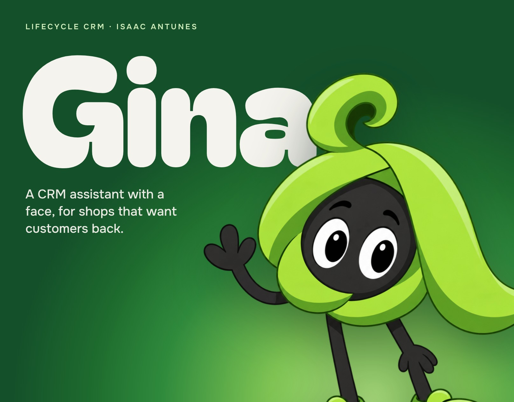

### 01 · Hero Opening
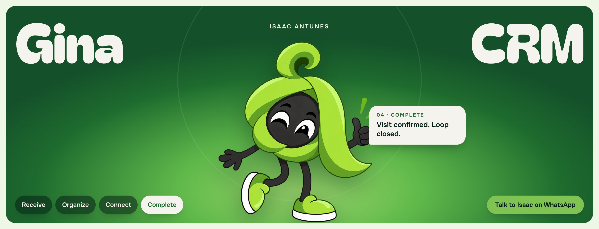

### 02 · The Concept

### 03 · Meet Gina
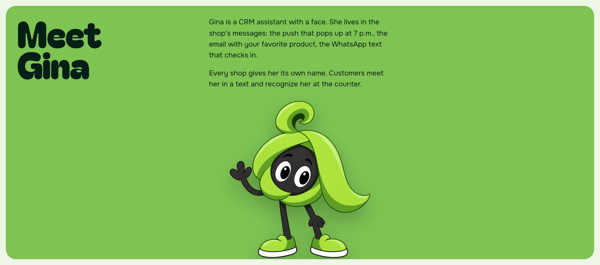

### 04 · Four Lifecycle Modes
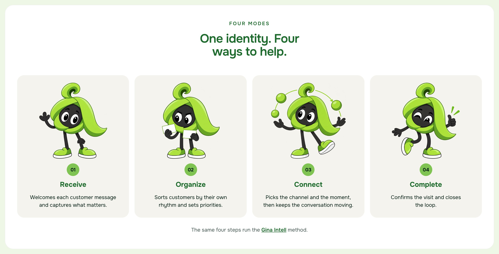

### 05 · App Icon System
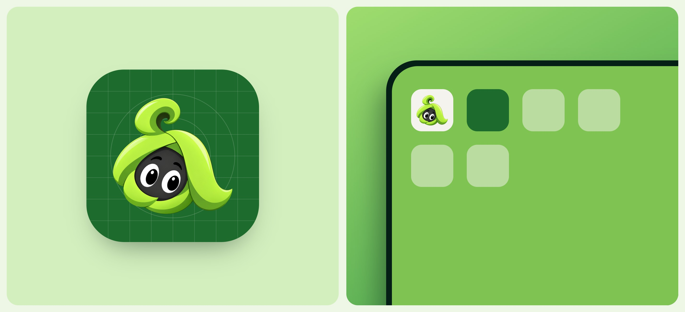

### 06 · Multi-Scale Avatar System
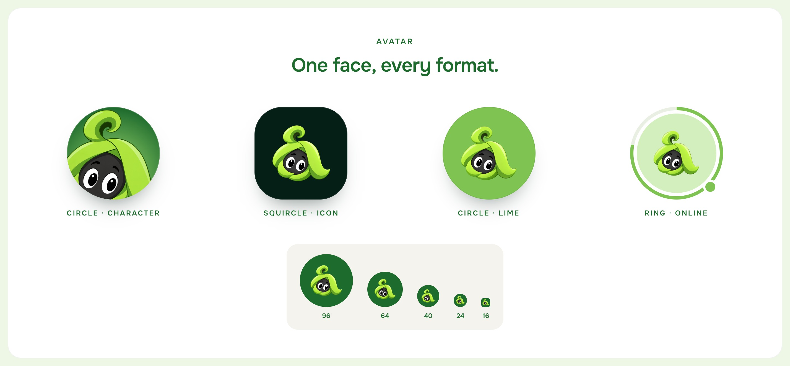

### 07 · Brand Identity Kit
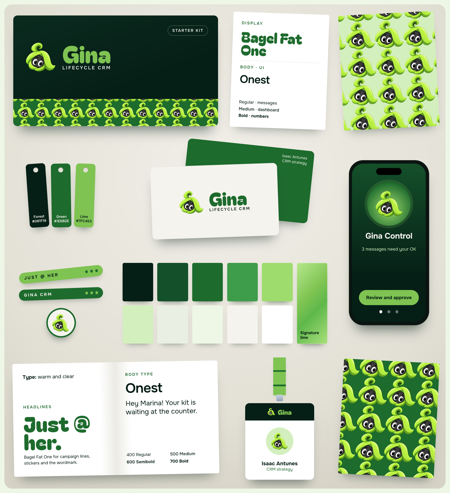

### 08 · Interface Component Kit
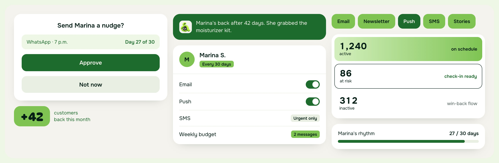

### 09 · Cross-Channel Customer Journey
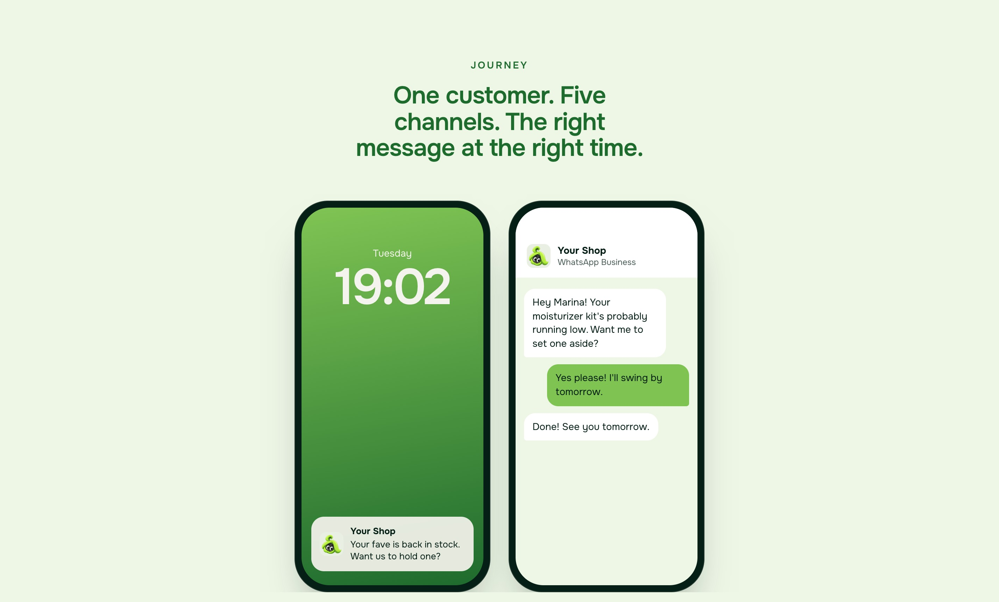

### 10 · Multi-Device Surfaces
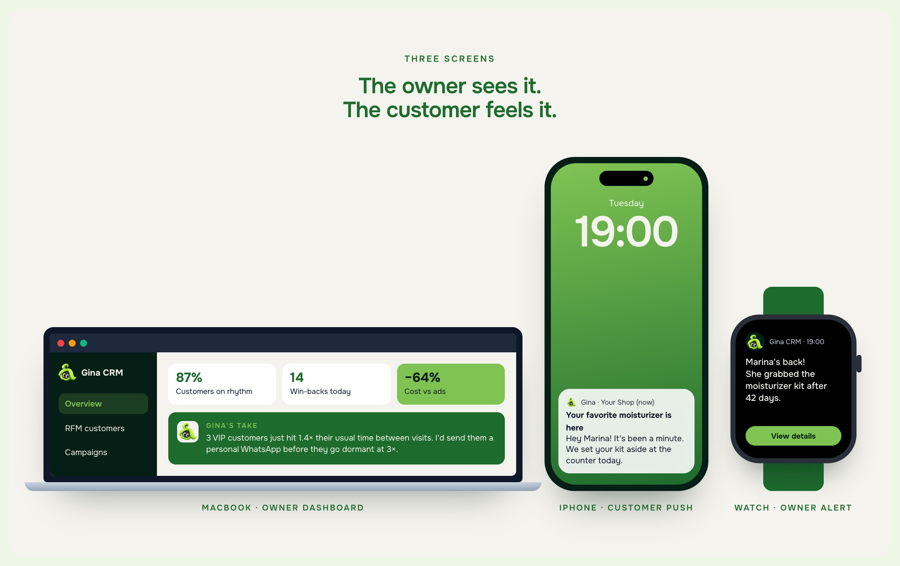

### 11 · Campaign Expression
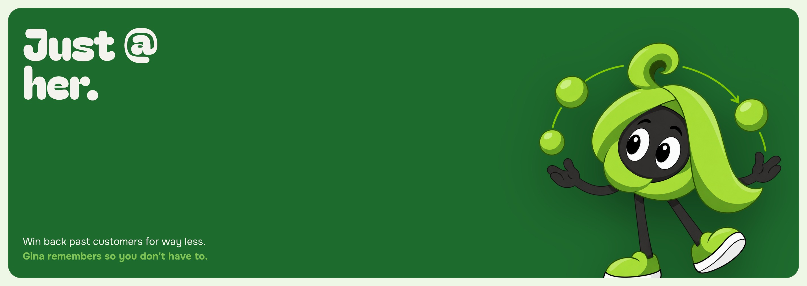

### 12 · Physical & Merch Applications
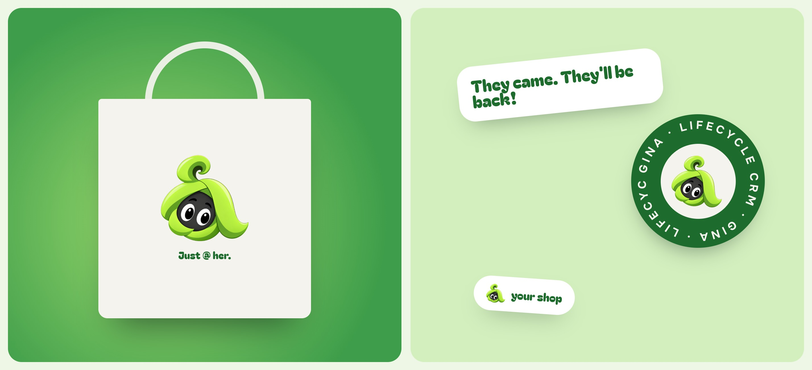

### 13 · Loyalty Wallet Card
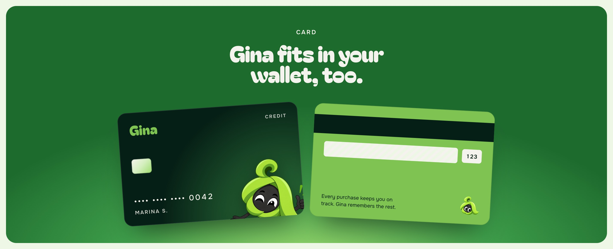

### 14 · Retention Economics

### 15 · Closing & Contact
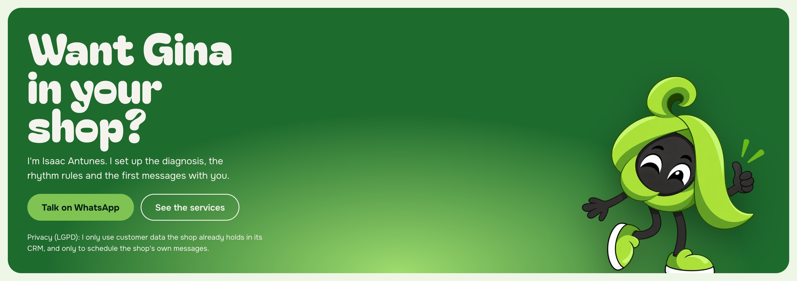

---

© 2026 Isaac Antunes. Character, illustrations, and visual system: all rights reserved. See [LICENSE](../LICENSE).
